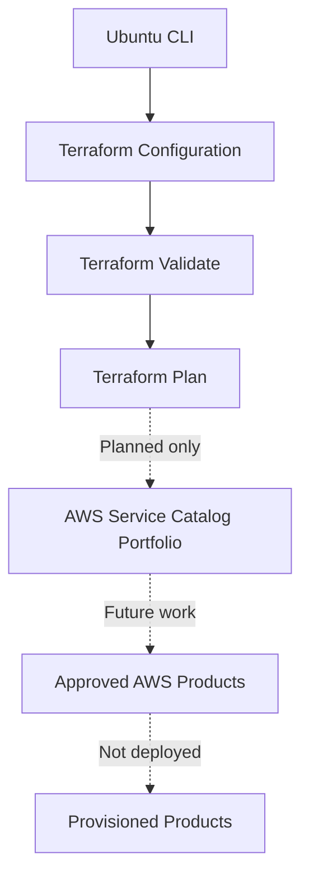
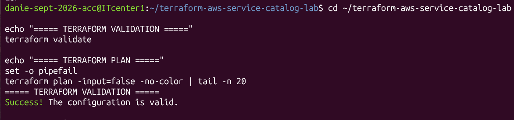

# AWS Service Catalog Terraform Lab

## Project Status

**PLAN ONLY — No AWS resources deployed by this project.**

## Project Overview

This project demonstrates how to define an AWS Service Catalog portfolio using Terraform.

AWS Service Catalog helps organizations organize and distribute approved AWS infrastructure products.

This lab proposes one new learning portfolio without creating products or provisioning infrastructure.

## Architecture



The diagram shows the planned architecture and possible future extensions.

## Technology Stack

- AWS Service Catalog
- Terraform
- AWS CLI
- Ubuntu Linux
- Git and GitHub

## Planned AWS Resource

| Resource | Purpose | Status |
|---|---|---|
| `aws_servicecatalog_portfolio.learning_portfolio` | Organize approved AWS infrastructure products | Planned only |

## Portfolio Configuration

- Name: `terraform-cloud-governance-learning`
- Description: Learning portfolio for approved AWS infrastructure products
- Provider: Cloud Engineering Lab
- Region: `us-east-1`
- Environment: learning
- Managed by: Terraform

No products, launch constraints, IAM associations, or provisioned products are configured.

## AWS Environment Discovery

Read-only AWS CLI discovery identified an existing portfolio:

- Name: AWS Control Tower Account Factory Portfolio
- Portfolio ID: `port-6jrh7auvpj3za`

The discovery commands returned no available products or provisioned products for the current IAM user.

The existing AWS Control Tower portfolio is not managed or modified by this project.

## Terraform Validation

Commands:

```bash
terraform init
terraform fmt -check
terraform validate
terraform plan -input=false -no-color
```

Observed results:

- Terraform formatting passed.
- Terraform validation succeeded.
- Terraform plan succeeded.
- Plan: 1 to add, 0 to change, 0 to destroy.

No Terraform apply was executed.

## Validation Evidence

See [Validation Evidence](docs/validation-evidence.md).



## Security Considerations

- Do not commit AWS credentials or private keys.
- Do not commit Terraform state files.
- Use least-privilege IAM permissions.
- Do not modify existing AWS Control Tower resources.
- Do not provision unapproved AWS products.

## Cost Considerations

This project is PLAN ONLY.

Provisioning Service Catalog products can launch AWS resources that incur charges.

## Future Improvements

- Create an approved Service Catalog product.
- Define product versions.
- Configure portfolio access for authorized IAM principals.
- Add appropriate launch constraints.
- Test product provisioning in an authorized sandbox environment.

These improvements are not implemented in the current project.

## Project Outcome

Successfully created and validated a Terraform configuration proposing one new AWS Service Catalog portfolio.

No AWS resources were deployed.
